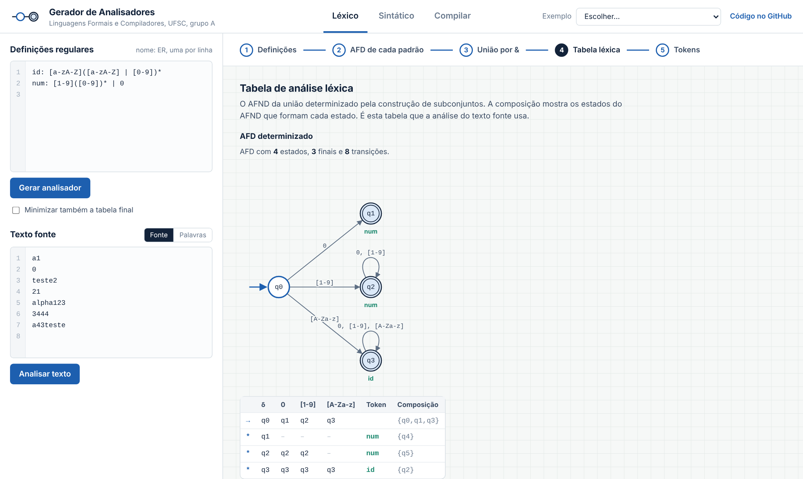

<p align="center">
  
</p>

<p align="center">
  <a href="https://github.com/robertotxr/lfc-gerador-analisadores/actions/workflows/testes.yml"></a>
  
  
  
</p>

Trabalhos I e II de **Linguagens Formais e Compiladores** (UFSC, 2026/2, Profa. Jerusa Marchi): um gerador de analisadores léxicos e um gerador de analisadores sintáticos SLR, que funcionam separados ou integrados, e a linguagem do grupo, a **Manezês**.

**Grupo A:** Claudio Gerolimetto, Maria Júlia de Melo Honorato, Murilo Leite Filho e Roberto Becker Teixeira.

## Como rodar

Precisa só de Python 3.8+, sem nada para instalar.

```bash
git clone https://github.com/robertotxr/lfc-gerador-analisadores.git
cd lfc-gerador-analisadores
python3 main.py web                     # interface gráfica no navegador
python3 main.py                         # menu no terminal
python3 rodar_exemplos.py               # roda todos os exemplos (saídas em saida/exemplos/)
python3 -m unittest discover testes     # testes automáticos
```

<p align="center"></p>

A interface tem uma aba para cada parte: **Léxico** (definições regulares, os autômatos de cada etapa desenhados e em tabela, e o texto fonte com cada token destacado), **Sintático** (First/Follow, coleção LR(0), tabela SLR e a pilha passo a passo) e **Compilar** (os dois juntos sobre um programa, com a pilha andando sobre o código). Todos os exemplos do repositório, inclusive a Manezês, carregam pelo seletor no topo.

## O que foi implementado

| Algoritmo (livro do Aho) | Arquivo |
|---|---|
| ER → AFD pela conversão direta (followpos) | `lexico/er_afd.py` |
| Minimização de AFD | `lexico/minimizacao.py` |
| União de autômatos por &-transição | `lexico/uniao.py` |
| Determinização (subconjuntos com &-fecho) | `lexico/determinizacao.py` |
| First e Follow (seção 4.4.2) | `sintatico/first_follow.py` |
| Closure (fig. 4.32) e coleção canônica (fig. 4.33) | `sintatico/lr0.py` |
| Tabela SLR (alg. 4.46) | `sintatico/slr.py` |
| Análise LR com pilha (alg. 4.44, fig. 4.36) | `sintatico/analisador.py` |

**Léxico.** Cada definição regular vira um AFD, que é minimizado; os AFDs mínimos são unidos por `&` e o AFND resultante é determinizado, gerando a tabela de análise léxica. Todos esses autômatos aparecem em forma de tabela (na tela, em `.txt`/`.csv` e como grafo `.dot`). Na execução, o texto fonte vira a lista `<lexema, padrão>` ou `<lexema, erro!>`, usando o casamento mais longo; se um lexema casa com dois padrões, vence o definido primeiro.

**Sintático.** A partir da gramática são calculados First/Follow, a coleção canônica LR(0) e a tabela SLR; conflitos são listados com estado e símbolo. As palavras reservadas entram na tabela de símbolos antes da análise: identificadores e constantes viram `<id, linha da TS>` e palavras reservadas viram `<for, PR>`. A execução lê a lista de tokens do léxico e mostra a pilha passo a passo, dizendo se o código está correto ou onde está o erro.

## Uso

Cada parte tem uma interface de projeto (gera a tabela) e uma de execução (usa a tabela):

```bash
# Trabalho I
python3 main.py lexico projetar exemplos/lexico/01_enunciado_id_num/definicoes.er -o saida/ex1
python3 main.py lexico executar saida/ex1/analisador_lexico.json exemplos/lexico/01_enunciado_id_num/entrada.txt

# Trabalho II
python3 main.py sintatico projetar exemplos/sintatico/01_expressoes_aho/gramatica.glc -o saida/aho
python3 main.py sintatico executar saida/aho/analisador_sintatico.json exemplos/sintatico/01_expressoes_aho/tokens_correto.txt

# Os dois juntos sobre um código fonte
python3 main.py compilar linguagem/correto.mane --lexico linguagem/lexico.er --gramatica linguagem/sintatico.glc --pr linguagem/palavras_reservadas.txt
```

Os relatórios completos (followpos, AFDs, coleção canônica, tabelas) ficam na pasta passada em `-o`. `python3 main.py <comando> -h` mostra as opções.

## Formatos de entrada

**Definições regulares**, uma por linha, como no enunciado:

```
id: [a-zA-Z]([a-zA-Z] | [0-9])*
num: [1-9]([0-9])* | 0
```

Aceita `[a-z]`, `[^...]`, `|`, `*`, `+`, `?`, parênteses e `&` (ε). Dentro de `[ ]` todo caractere é literal, então símbolos de operador podem ser escritos como `[+]` ou `[(]` (ou escapados: `\+`). `{nome}` referencia outra definição, que passa a ser auxiliar (não gera token).

**Gramática**, uma produção por linha, com não terminais entre `< >`, caracteres especiais entre aspas e `&` para a palavra vazia:

```
<E> ::= <E> "+" <T>
<T> ::= id
```

**Palavras reservadas**: uma por linha. **Tokens** (entrada do sintático): uma linha `<a, b>` por token, no formato do Trabalho I (`<x1, id>`) ou com tabela de símbolos (`<id, 21>`, `<for, PR>`).

## A linguagem Manezês

Linguagem imperativa com o sotaque de Florianópolis. Um programa tem funções (`pesca`) e o bloco principal (`ilha`):

```
pesca tainha fatorial(tainha n) {
  capaz (n <= 1) {
    traz 1;
  }
  traz n * fatorial(n - 1);
}

ilha Floripa {
  tainha quantas = 0;
  escuta(quantas);
  rema i de 1 ate quantas {
    capaz (i % 2 == 0 e nao (i == 4)) {
      fala("par:", i);
    } ouentao {
      fala("impar:", fatorial(i));
    }
  }
}
```

| Manezês | Significado | | Manezês | Significado |
|---|---|---|---|---|
| `ilha` | programa principal | | `capaz` / `ouentao` | se / senão |
| `pesca` / `traz` | função / retorno | | `segue` | enquanto |
| `tainha` / `berbigao` | inteiro / real | | `rema i de a ate b` | repetição contada |
| `fofoca` / `tasounao` | cadeia / lógico | | `fala` / `escuta` | escrita / leitura |
| `dazumbanda` / `tastolo` | verdadeiro / falso | | `e`, `ou`, `nao` | operadores lógicos |

Os arquivos estão em [`linguagem/`](linguagem): definição léxica (`lexico.er`), sintática (`sintatico.glc`, 72 produções, SLR(1) sem conflitos), palavras reservadas e três programas: `correto.mane` (aceito), `com_erro.mane` (erro sintático na linha 3: o `capaz` exige `(`) e `com_erro_lexico.mane` (o `@` da linha 3 não é token).

Para rodar em outros geradores, os arquivos usam só a notação básica do enunciado: sem comentários, sem `{nome}`, sem `\` e sem espaço dentro de classes (por isso as cadeias dos exemplos usam `_` no lugar de espaço). `id`, `num`, `real` e `cadeia` são nomes de padrão do léxico; os terminais entre aspas da gramática são lexemas.

## Exemplos e testes

`exemplos/` tem 8 definições léxicas (os dois exemplos do enunciado, definições auxiliares, operadores, cadeias, erros, prioridade) e 6 gramáticas (incluindo as do livro: a de expressões, cuja tabela bate com a fig. 4.37, e uma que não é SLR(1)). Sobre o exemplo 2 do enunciado: `a?(a|b)+` e `b?(a|b)+` denotam a mesma linguagem, então todo lexema casa com as duas e `er1` sempre vence; `definicoes_intencao.er`, na mesma pasta, dá a saída do PDF.

Os testes comparam os autômatos com o módulo `re` do Python em todas as palavras curtas de 400 ERs aleatórias, e o analisador SLR com um reconhecedor Earley, além dos exemplos do livro e da API da interface.

## Estrutura

```
main.py          linha de comando e menu interativo
web/             interface gráfica (servidor local com a biblioteca padrão + HTML/CSS/JS)
lexico/          Trabalho I: ER, conversão, minimização, união, determinização, analisador
sintatico/       Trabalho II: gramática, First/Follow, LR(0), tabela SLR, analisador LR
comum/           tabela de símbolos, formato de tokens, tabelas em texto
linguagem/       a Manezês
exemplos/        exemplos léxicos e sintáticos
testes/          testes automáticos
```
