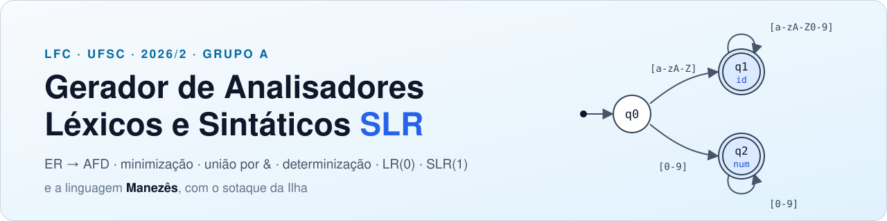
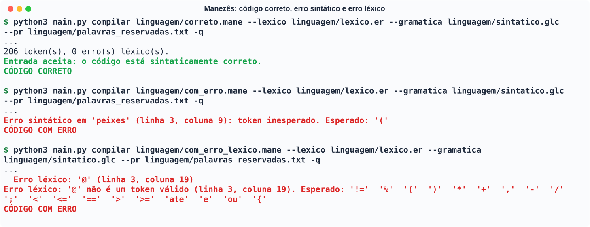
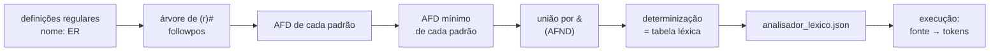
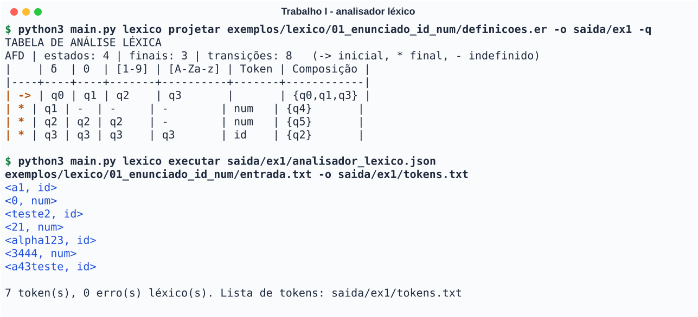
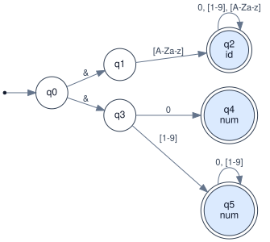
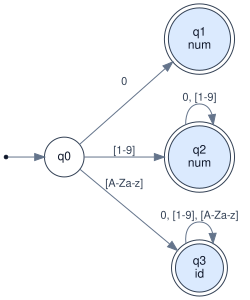
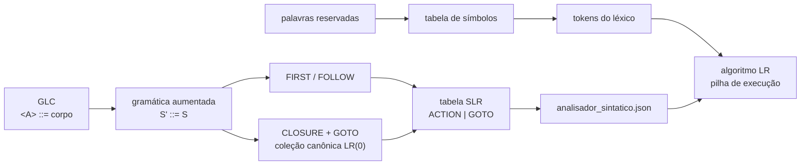
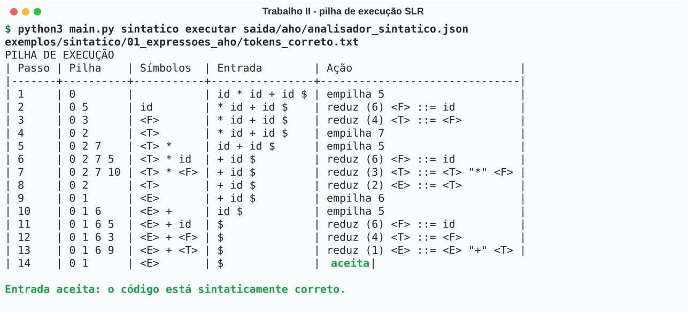
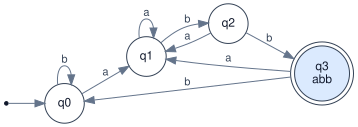

<p align="center">
  
</p>

<p align="center">
  <a href="https://github.com/robertotxr/lfc-gerador-analisadores/actions/workflows/testes.yml"></a>
  
  
  
  
</p>

**Linguagens Formais e Compiladores — UFSC — Profa. Jerusa Marchi — 2026/2**<br>
Trabalho I (Gerador de Analisadores Léxicos) e Trabalho II (Gerador de Analisadores Sintáticos SLR), integrados, e a linguagem do grupo: **Manezês**.

**Grupo A:** Claudio Gerolimetto · Maria Júlia de Melo Honorato · Murilo Leite Filho · Roberto Becker Teixeira

```bash
git clone https://github.com/robertotxr/lfc-gerador-analisadores.git
cd lfc-gerador-analisadores
python3 main.py          # menu interativo
```

Python 3.8 ou mais novo, só biblioteca padrão: não tem nada para instalar.

---

## Por onde começar

| Você é... | Leia |
|---|---|
| **Professora** | [O que o enunciado pede e onde está](#1-o-que-o-enunciado-pede-e-onde-está) e [Como testar cada parte](#2-como-testar-cada-parte) |
| **Outro grupo** querendo rodar a Manezês | [A linguagem Manezês](#6-a-linguagem-manezês) e [Rodando a Manezês no gerador de vocês](#7-para-os-outros-grupos) |
| **Outro grupo** querendo rodar a sua linguagem aqui | [Rodando a linguagem de vocês no nosso gerador](#rodando-a-linguagem-de-vocês-no-nosso-gerador) |
| **Integrante do grupo** | [Como funciona por dentro](#8-como-funciona-por-dentro), [Roteiro da apresentação](#9-roteiro-da-apresentação-5-min) e [Perguntas prováveis](#10-perguntas-prováveis-na-apresentação) |

## Sumário

1. [O que o enunciado pede e onde está](#1-o-que-o-enunciado-pede-e-onde-está)
2. [Como testar cada parte](#2-como-testar-cada-parte)
3. [Trabalho I: gerador de analisadores léxicos](#3-trabalho-i-gerador-de-analisadores-léxicos)
4. [Trabalho II: gerador de analisadores sintáticos SLR](#4-trabalho-ii-gerador-de-analisadores-sintáticos-slr)
5. [Integração: compilar um fonte](#5-integração-compilar-um-fonte)
6. [A linguagem Manezês](#6-a-linguagem-manezês)
7. [Para os outros grupos](#7-para-os-outros-grupos)
8. [Como funciona por dentro](#8-como-funciona-por-dentro)
9. [Roteiro da apresentação (5 min)](#9-roteiro-da-apresentação-5-min)
10. [Perguntas prováveis na apresentação](#10-perguntas-prováveis-na-apresentação)
11. [Exemplos de teste](#11-exemplos-de-teste)
12. [Testes automáticos](#12-testes-automáticos)
13. [Estrutura do repositório](#13-estrutura-do-repositório)
14. [Limitações conhecidas](#14-limitações-conhecidas)

---

## 1. O que o enunciado pede e onde está

### Trabalho I — Gerador de Analisadores Léxicos

| Enunciado | Onde está |
|---|---|
| (a) Conversão de ER para AFD (algoritmo do livro do Aho) | `lexico/er_afd.py` — método direto: árvore de `(r)#`, nullable, firstpos, lastpos, followpos |
| (b) Minimização de autômatos | `lexico/minimizacao.py` — inalcançáveis, mortos, classes de equivalência |
| (c) União de autômatos via ε-transição | `lexico/uniao.py` — novo estado inicial com `&` para cada AFD |
| (d) Determinização de autômatos | `lexico/determinizacao.py` — subconjuntos com &-fecho |
| Interface de projeto com ERs para todos os padrões, usando definições regulares | `python3 main.py lexico projetar` (ou opção 1 do menu, que também deixa digitar as ERs) — `lexico/er.py` lê `nome: ER` e aceita `{nome}` |
| Para cada ER, o AFD correspondente; AFDs minimizados e unidos; AFND determinizado = tabela de análise léxica | `lexico/gerador.py` — tudo aparece no relatório |
| Tabela léxica e AFDs visualizáveis (arquivo ou tela, em tabela) | tela + `relatorio_lexico.txt`, `tabela_lexica.txt`/`.csv` e grafos `.dot` |
| Interface de execução: texto fonte → arquivo com `<lexema, padrão>` ou `<lexema, erro!>` | `python3 main.py lexico executar` — `lexico/analisador.py` |
| Notação de sala, `&` para ε | ERs e gramáticas usam `&` |
| Fontes, executável, HowTo e exemplos variados com definições léxicas diferentes | este README, `main.py`, `exemplos/lexico/` (8 definições léxicas) |

### Trabalho II — Gerador de Analisadores Sintáticos SLR

| Enunciado | Onde está |
|---|---|
| (a) First e Follow (seção 4.4.2) | `sintatico/first_follow.py` |
| (b) Closure (fig. 4.32) | `sintatico/lr0.py` → `closure()` |
| (c) Coleção canônica (fig. 4.33) | `sintatico/lr0.py` → `goto()` e `colecao_canonica()` |
| (d) LR Parsing (alg. 4.44, fig. 4.36) | `sintatico/analisador.py` → `analisar()` |
| (e) Tabela SLR (alg. 4.46) | `sintatico/slr.py` → `construir_slr()` |
| Interface de projeto: GLC no formato `<NT> ::= corpo`, uma produção por linha, terminais especiais entre aspas, `&` | `python3 main.py sintatico projetar` — `sintatico/gramatica.py` |
| Lista de palavras reservadas armazenada na TS a priori | `comum/tabela_simbolos.py`; arquivo `--pr` |
| Variáveis e constantes na TS, token `<id, end_TS>`; palavra reservada casa com id mas a TS devolve `<for, PR>` | `lexico/analisador.py` → `aplicar_tabela_simbolos()` |
| Interface de execução: entrada = lista de tokens do léxico, saída = pilha de execução e se o código está correto | `python3 main.py sintatico executar` |
| Definição léxica e sintática de uma linguagem do grupo + fonte correto e com erro | `linguagem/` (Manezês) |

---

## 2. Como testar cada parte

As partes funcionam **separadas** (cada uma com interface de projeto e de execução) e **juntas** (`compilar`). Todos os comandos rodam a partir da raiz do repositório; `python3 main.py <comando> -h` mostra as opções.

```bash
# Trabalho I: projeto e execução do léxico (exemplo 1 do enunciado)
python3 main.py lexico projetar exemplos/lexico/01_enunciado_id_num/definicoes.er -o saida/ex1
python3 main.py lexico executar saida/ex1/analisador_lexico.json exemplos/lexico/01_enunciado_id_num/entrada.txt -o saida/ex1/tokens.txt

# Trabalho II: projeto e execução do sintático (gramática 4.1 do Aho)
python3 main.py sintatico projetar exemplos/sintatico/01_expressoes_aho/gramatica.glc -o saida/aho
python3 main.py sintatico executar saida/aho/analisador_sintatico.json exemplos/sintatico/01_expressoes_aho/tokens_correto.txt

# Integrado: a linguagem do grupo
python3 main.py compilar linguagem/correto.mane --lexico linguagem/lexico.er --gramatica linguagem/sintatico.glc --pr linguagem/palavras_reservadas.txt
python3 main.py compilar linguagem/com_erro.mane --lexico linguagem/lexico.er --gramatica linguagem/sintatico.glc --pr linguagem/palavras_reservadas.txt

# Tudo de uma vez
python3 rodar_exemplos.py               # todos os exemplos, saídas em saida/exemplos/
python3 -m unittest discover testes     # 45 testes automáticos (~30 s)
```

<p align="center"></p>

O **menu interativo** (`python3 main.py`) faz as mesmas coisas perguntando os arquivos, e deixa **digitar** as definições regulares, a gramática ou o texto fonte na hora (terminando com uma linha `FIM`).

---

## 3. Trabalho I: gerador de analisadores léxicos



### Interface de projeto

```bash
python3 main.py lexico projetar DEFINICOES.er -o PASTA [--minimizar-tabela] [-q]
```

Mostra na tela e grava em `PASTA/relatorio_lexico.txt`, para **cada padrão de token**:

1. a ER expandida e aumentada `(r)#`, as posições das folhas, `firstpos(raiz)` e a tabela de **followpos**;
2. o **AFD da conversão direta**, com a composição de cada estado (o conjunto de posições);
3. a **minimização**: estados inalcançáveis e mortos eliminados, classes de equivalência e o AFD mínimo;

e depois, para o conjunto:

4. o **AFND da união** de todos os AFDs mínimos por `&`-transições;
5. o **AFD determinizado**, que é a **tabela de análise léxica**, com a composição de cada estado (estados do AFND) e o padrão de cada estado final;
6. os estados finais disputados por mais de um padrão e outros avisos.

Projeto e execução do exemplo 1 do enunciado (`id` e `num`):

<p align="center"></p>

Os mesmos autômatos como grafo (gerados pelos arquivos `.dot`):

| União dos AFDs mínimos por `&` (AFND) | Determinizado = tabela de análise léxica |
|:---:|:---:|
|  |  |

Arquivos gerados em `PASTA/`:

| Arquivo | Conteúdo |
|---|---|
| `analisador_lexico.json` | a tabela de análise léxica, lida pela interface de execução |
| `relatorio_lexico.txt` | o relatório completo (itens 1 a 6) |
| `tabela_lexica.txt` / `.csv` | só a tabela final (o `.csv` abre no Excel/Sheets) |
| `dot/*.dot` | cada autômato como grafo; com Graphviz: `dot -Tpng dot/tabela_lexica.dot -o tabela.png` |

Opções: `--minimizar-tabela` minimiza também o AFD final, sem juntar estados finais de padrões diferentes; `-q` mostra só a tabela final.

### Interface de execução

```bash
python3 main.py lexico executar PASTA/analisador_lexico.json FONTE [-o tokens.txt] [--palavras] [--pr PR.txt | --sintatico SIN.json]
```

Saída: um token por linha, `<lexema, padrão>` ou `<lexema, erro!>`.

```
<a1, id>
<0, num>
<teste2, id>
<21, num>
```

- **Modo fonte (padrão):** casamento mais longo (*maximal munch*). Os tokens podem estar colados (`x:=a+1;` vira 6 tokens) e espaço, tab e quebra de linha separam tokens. O analisador lembra o último estado final por onde passou, então `7.5E` vira `<7.5, numero>` e `<E, id>`. Se nada casa, o lexema de erro é o caractere atual mais os seguintes que também não podem começar token; a análise continua depois dele. Cada erro informa linha e coluna.
- **`--palavras`:** cada palavra separada por espaço tem que ser um token inteira, senão é `<palavra, erro!>`. Serve para listas de palavras como as do enunciado.
- **`--pr` / `--sintatico`:** usa a tabela de símbolos do Trabalho II ([seção 4](#tabela-de-símbolos-e-palavras-reservadas)) e grava `<id, 10>`, `<for, PR>`; a TS vai para `<saida>_tabela_simbolos.txt`.

### Formato das definições regulares

Uma definição por linha, como no Anexo I: `nome: ER`. Linhas vazias e linhas que começam com `#` são ignoradas.

| Sintaxe | Significado |
|---|---|
| `abc` | símbolos literais concatenados; espaços fora de `[ ]` são ignorados |
| `[a-zA-Z_]` `[0-9]` | classe de caracteres; dentro de `[ ]` todo caractere é literal (inclusive espaço, `(`, `+`, `*`, `.`) e `-` no começo ou no fim é literal |
| `[^"\n]` | classe negada: todos os caracteres imprimíveis, inclusive acentuados, menos os listados |
| `r1 \| r2` | união |
| `r*` `r+` `r?` | fecho, fecho positivo, opcional |
| `( r )` | agrupamento |
| `&` | palavra vazia (ε) |
| `{nome}` | referência a outra definição regular |
| `\x` | escape: `\n` `\t` `\r`, `\s` (espaço) e qualquer outro caractere literal: `\+ \* \? \| \( \) \[ \{ \& \\` |

Regras:

- **Definições auxiliares.** Uma definição referenciada por outra com `{nome}` é auxiliar e não gera token, como `letra` e `digito` no estilo do Aho. As demais são padrões de token. Podem ser referenciadas antes ou depois de definidas; referência circular é erro.
- **Prioridade.** Se um lexema casa com mais de um padrão, vence o que aparece primeiro no arquivo. Por isso palavras-chave escritas como padrão (`se: se`) vêm antes de `id` (ou ficam na lista de palavras reservadas do Trabalho II).
- **Palavra vazia.** Nenhum token tem 0 caracteres; se um padrão aceita ε, o gerador avisa e o ε é ignorado.
- **Avisos.** O gerador avisa padrões que nunca serão reconhecidos (todas as palavras deles são de padrões com mais prioridade) e nomes de definição escritos sem chaves (em `id: letra(letra|digito)*`, `letra` vale como texto literal).

```
letra: [a-zA-Z_]
digito: [0-9]
digitos: {digito}+
id: {letra}({letra} | {digito})*
numero: {digitos}([.]{digitos})?(E[+-]?{digitos})?
```

> **Sobre o exemplo 2 do enunciado** (`er1: a?(a|b)+` e `er2: b?(a|b)+`): as duas ERs denotam **a mesma linguagem**, `(a|b)+`. Nenhum analisador determinístico consegue separar "começa com a" de "começa com b" com elas: todo lexema casa com as duas e `er1` vence pela prioridade. O gerador avisa que `er2` nunca será reconhecido. O arquivo `exemplos/lexico/02_enunciado_ab/definicoes_intencao.er` (`er1: a(a|b)*`, `er2: b(a|b)*`) produz exatamente a saída mostrada no enunciado.

---

## 4. Trabalho II: gerador de analisadores sintáticos SLR



### Interface de projeto

```bash
python3 main.py sintatico projetar GRAMATICA.glc [--pr PALAVRAS_RESERVADAS.txt] -o PASTA [-q]
```

Mostra na tela e grava em `PASTA/relatorio_sintatico.txt`:

1. a gramática aumentada com as produções numeradas (a produção 0 é `S' ::= S`);
2. a tabela de símbolos com as palavras reservadas pré-carregadas;
3. **FIRST e FOLLOW** de cada não terminal;
4. a **coleção canônica LR(0)**: cada estado `Ii` com seus itens e as transições `GOTO(Ii, X) = Ij`;
5. a **tabela SLR** (ACTION | GOTO): `s5` = empilha e vai ao estado 5, `r3` = reduz pela produção 3, `acc` = aceita, número = desvio;
6. se a gramática é SLR(1) ou a lista de conflitos.

Para a gramática 4.1 do Aho, a tabela gerada é a da fig. 4.37:

```
| Estado | +  | *  | (  | )   | id | $   | <E> | <T> | <F> |
|--------+----+----+----+-----+----+-----+-----+-----+-----|
| 0      |    |    | s4 |     | s5 |     | 1   | 2   | 3   |
| 1      | s6 |    |    |     |    | acc |     |     |     |
| 2      | r2 | s7 |    | r2  |    | r2  |     |     |     |
| 3      | r4 | r4 |    | r4  |    | r4  |     |     |     |
| 4      |    |    | s4 |     | s5 |     | 8   | 2   | 3   |
| 5      | r6 | r6 |    | r6  |    | r6  |     |     |     |
| 6      |    |    | s4 |     | s5 |     |     | 9   | 3   |
| 7      |    |    | s4 |     | s5 |     |     |     | 10  |
| 8      | s6 |    |    | s11 |    |     |     |     |     |
| 9      | r1 | s7 |    | r1  |    | r1  |     |     |     |
| 10     | r3 | r3 |    | r3  |    | r3  |     |     |     |
| 11     | r5 | r5 |    | r5  |    | r5  |     |     |     |
```

**Gramática que não é SLR(1):** os conflitos (empilha/reduz ou reduz/reduz) são listados com o estado, o símbolo e as ações em disputa, e a célula aparece marcada com `!`. A tabela é gerada mesmo assim, resolvendo empilhar > reduzir e, entre reduções, a produção que vem primeiro (como o yacc faz), e a execução avisa que está usando uma tabela com conflitos. Veja `exemplos/sintatico/02_nao_slr_aho` (gramática 4.49 do Aho) e `04_if_else_ambigua` (else pendente).

Arquivos gerados: `analisador_sintatico.json` (lido pela execução), `relatorio_sintatico.txt`, `tabela_slr.txt` e `tabela_slr.csv`.

### Interface de execução

```bash
python3 main.py sintatico executar PASTA/analisador_sintatico.json TOKENS.txt [-o pilha.txt]
```

Lê a lista de tokens produzida pelo léxico e mostra a **pilha de execução** passo a passo (algoritmo da fig. 4.36), como na fig. 4.38 do Aho:

<p align="center"></p>

No erro, a pilha para no passo do erro e a mensagem diz o token, onde ele está e quais terminais eram esperados:

```
Erro sintático em 'peixes' (linha 3, coluna 9): token inesperado. Esperado: '('
```

Na tela, entrada e pilha muito longas aparecem cortadas com `...`; o arquivo tem tudo.

### Formato da gramática

Uma produção por linha, como no enunciado:

```
<Expr> ::= <Expr> "+" <Termo>
<Expr> ::= <Termo>
<Fator> ::= "(" <Expr> ")"
<Fator> ::= id
<Lista> ::= &
```

- não terminais entre `< >` (também `⟨ ⟩`; o nome pode ter espaço: `<Lista Comandos>`);
- terminais escritos direto (`id`, `num`, `if`) ou, para caracteres especiais, entre aspas (`"("`, `“[”`); os símbolos são separados por espaço; `$` é reservado ao fim da entrada;
- `&` (ou `ε`) é a palavra vazia;
- também aceita `|` na mesma linha, linhas de continuação começando com `|`, `->`/`→` no lugar de `::=` e comentários com `#` ou `//` (veja `exemplos/sintatico/06_formatos_alternativos`);
- o símbolo inicial é o da primeira produção; o gerador avisa sobre não terminais inalcançáveis ou improdutivos e dá erro para não terminal usado sem produção.

### Tabela de símbolos e palavras reservadas

O arquivo de palavras reservadas tem uma ou mais palavras por linha. Elas entram na TS **antes** da análise, com a categoria `PR`. As palavras reservadas casam com o padrão `id` no léxico, mas a consulta à TS devolve a categoria guardada lá, como pede o enunciado. Para cada lexema reconhecido:

| Situação | Token |
|---|---|
| já está na TS como palavra reservada | `<for, PR>` |
| só caracteres especiais (sem letra, dígito ou `_`) | `<lexema, padrão>`: `<(, delim>`, `<<=, op_rel>` |
| identificador, constante ou cadeia já na TS | o token lá indicado: `<id, 21>` |
| identificador, constante ou cadeia ainda fora da TS | insere e devolve `<padrão, linha da TS>`: `<id, 22>`, `<num, 23>` |
| erro léxico | `<lexema, erro!>` |

As linhas da TS começam em 1 (com as 20 palavras reservadas da Manezês, o primeiro identificador fica na linha 21).

### Como cada token vira um terminal da gramática

O sintático aceita os dois formatos de arquivo de tokens: o do Trabalho I (`<x1, id>`, `<for, id>`, `<(, delim>`) e o com TS (`<id, 21>`, `<for, PR>`, `<(, delim>`). Para um token `<a, b>`:

1. se `a` é palavra reservada (ou `b` é `PR`) → o terminal é `a` (`for`);
2. senão, se `b` é terminal da gramática → `b` (`<x1, id>` → `id`);
3. senão, se `a` é terminal → `a` (`<(, delim>` → `(`, `<id, 21>` → `id`);
4. senão o token não pertence à gramática e a análise para com erro nele (um `<@, erro!>` vira "Erro léxico: '@' não é um token válido").

---

## 5. Integração: compilar um fonte

```bash
python3 main.py compilar FONTE --lexico LEXICO.er --gramatica GRAMATICA.glc --pr PALAVRAS_RESERVADAS.txt [-o PASTA] [-q]
```

Faz tudo em sequência: projeta o léxico e o sintático, confere se todo terminal da gramática pode ser produzido pelo léxico (avisa, por exemplo, uma palavra-chave que ficou fora da lista de reservadas), analisa o fonte com a TS e roda o algoritmo LR. Grava em `saida/<fonte>/` (ou `PASTA`):

| Arquivo | Conteúdo |
|---|---|
| `tokens.txt` | tokens com TS: `<id, 21>`, `<capaz, PR>` |
| `tokens_lexemas.txt` | tokens no formato do Trabalho I: `<peixes, id>` |
| `tabela_simbolos.txt` | a TS no fim da análise |
| `pilha.txt` | a pilha de execução completa e o resultado |
| `lexico/`, `sintatico/` | relatórios e tabelas dos dois geradores |

Termina com `CÓDIGO CORRETO` (código de saída 0) ou `CÓDIGO COM ERRO` (código de saída 2).

---

## 6. A linguagem Manezês

Uma linguagem imperativa com o sotaque da Ilha da Magia. Um programa é uma lista de funções (`pesca`) seguida do bloco principal (`ilha`).

```
pesca tainha fatorial(tainha n) {
  capaz (n <= 1) {
    traz 1;
  }
  traz n * fatorial(n - 1);
}

ilha Floripa {
  tainha quantas = 0;
  escuta(quantas);
  rema i de 1 ate quantas {
    capaz (i % 2 == 0 e nao (i == 4)) {
      fala("par:", i);
    } ouentao capaz (i == 7) {
      fala("tainha_da_sorte!");
    } ouentao {
      fala("impar:", fatorial(i));
    }
  }
}
```

### Palavras reservadas

| Manezês | Significado | Por quê |
|---|---|---|
| `ilha` | programa principal | a Ilha de Santa Catarina |
| `pesca` | declara função | a gente vai pescar um resultado |
| `traz` | retorno | "traz a tainha!" |
| `tainha` | tipo inteiro | peixe se conta por unidade |
| `berbigao` | tipo real | |
| `fofoca` | tipo cadeia | é o que mais circula na ilha |
| `tasounao` | tipo lógico | "tás ou não tás?" |
| `dazumbanda` / `tastolo` | verdadeiro / falso | "dazumbanda" = de primeira; "tás tolo?" |
| `capaz` / `ouentao` | se / senão (`ouentao capaz` = senão se) | "capaz!" |
| `segue` | enquanto | "segue reto toda vida" |
| `rema i de a ate b` | repetição contada | de canoa |
| `fala(...)` / `escuta(x)` | escrita / leitura | |
| `e`, `ou`, `nao` | operadores lógicos | |

### Definição léxica (`linguagem/lexico.er`)

```
id: [a-zA-Z_]([a-zA-Z_]|[0-9])*
real: [0-9]+[.][0-9]+
num: [0-9]+
cadeia: "[a-zA-Z0-9,.!?:;_]*"
op_rel: <|<=|>|>=|==|!=
op_arit: [+*/%]|-
atrib: =
delim: [(){};,]
```

As 20 palavras reservadas (`linguagem/palavras_reservadas.txt`) casam com `id` e são separadas pela tabela de símbolos.

### Definição sintática (`linguagem/sintatico.glc`)

72 produções, uma por linha, **SLR(1) sem nenhum conflito** (130 estados LR(0)). Resumo:

- **Programa:** `<ListaFuncoes> ilha id <Bloco>`; função: `pesca <Tipo> id ( <Parametros> ) <Bloco>`.
- **Comandos:** declaração (`tainha x;` ou `tainha x = expr;`), atribuição, chamada de função, `fala(...)`, `escuta(x)` e `traz expr`, todos com `;`; `capaz (expr) <Bloco> <Senao>`, `segue (expr) <Bloco>` e `rema id de expr ate expr <Bloco>`. Como os blocos têm chaves obrigatórias, não existe o problema do else pendente.
- **Expressões**, da menor para a maior precedência: `ou`, `e`, `nao`, relacionais (`< <= > >= == !=`, não associativos), `+ -`, `* / %`, menos unário, parênteses, chamada de função e os literais (`id`, `num`, `real`, `cadeia`, `dazumbanda`, `tastolo`). A precedência sai da própria gramática (um não terminal por nível) e a associatividade à esquerda da recursão à esquerda.

### Programas de teste

| Arquivo | O que tem | Resultado esperado |
|---|---|---|
| `linguagem/correto.mane` | 3 funções e todas as construções da linguagem (206 tokens) | aceito (`CÓDIGO CORRETO`) |
| `linguagem/com_erro.mane` | `capaz peixes > 5 {` sem os parênteses | erro sintático na linha 3, coluna 9: esperado `(` |
| `linguagem/com_erro_lexico.mane` | `peixes = peixes @ 2;` | `<@, erro!>` na linha 3, coluna 19; o sintático para nele |

---

## 7. Para os outros grupos

### Rodando a Manezês no gerador de vocês

Os arquivos de `linguagem/` usam só o formato básico do enunciado, para rodarem em qualquer gerador:

- **léxico:** uma definição `nome: ER` por linha, sem comentários e sem referências entre definições; caracteres que costumam ser operadores de ER (`.`, `+`, `*`, `(`, `)`, `{`, `}`) aparecem **dentro de classes** (`[.]`, `[+*/%]`, `[(){};,]`) em vez de escapados com `\`; o `-` aparece fora de classe, sozinho numa alternativa;
- **sintaxe:** uma produção por linha, não terminais entre `< >`, terminais especiais entre aspas retas `"..."`, palavras reservadas e categorias (`id`, `num`, `real`, `cadeia`) sem aspas, `&` para a palavra vazia;
- **cadeias:** a classe de `cadeia` não tem espaço (muitos geradores removem os espaços da ER), então nos programas de exemplo as cadeias usam `_` no lugar de espaço: `"tainha_da_sorte!"`.

O que o gerador de vocês precisa fazer para a Manezês funcionar:

1. tratar as 20 palavras de `palavras_reservadas.txt` como reservadas (elas casam com `id`);
2. mapear os tokens para os terminais da gramática: `id`, `num`, `real` e `cadeia` são **nomes de padrão** do léxico; os terminais entre aspas (`"("`, `"<="`, `"+"`...) são **lexemas**; as palavras reservadas são o próprio lexema;
3. usar casamento mais longo, para `<=`, `>=`, `==` e `!=` não virarem dois tokens, e `3.0` não virar `3` e `.0`.

Resultados esperados: `correto.mane` é aceito; `com_erro.mane` tem erro sintático no token `peixes` da linha 3 (o `capaz` exige `(`); `com_erro_lexico.mane` tem erro léxico no `@` da linha 3.

### Rodando a linguagem de vocês no nosso gerador

```bash
git clone https://github.com/robertotxr/lfc-gerador-analisadores.git
cd lfc-gerador-analisadores
python3 main.py compilar SEU_FONTE --lexico SEU_LEXICO --gramatica SUA_GRAMATICA --pr SUAS_PALAVRAS_RESERVADAS
```

Dicas:

- A sintaxe de ER aceita está na [seção 3](#formato-das-definições-regulares). Se a ER de vocês usa um caractere de operador como literal, use classe (`[+]`) ou escape (`\+`).
- `{nome}` é referência a outra definição (e a definição referenciada vira auxiliar, sem token próprio); `{` sozinho ou seguido de algo que não é nome é literal.
- O nome de um padrão do léxico pode ser usado direto como terminal da gramática (`id`, `num`); símbolos vão entre aspas na gramática (`"("`).
- Palavras-chave: coloquem no arquivo de palavras reservadas (uma ou mais por linha). O `compilar` avisa se algum terminal da gramática não pode ser produzido pelo léxico.
- Se a gramática não for SLR(1), o relatório mostra o conflito com o estado e o símbolo; dá para seguir com a tabela resolvida (empilhar > reduzir), mas o ideal é ajustar a gramática.

---

## 8. Como funciona por dentro

### Léxico

**Classes de caracteres em vez de caracteres.** Uma transição não é sobre um caractere, é sobre um **bloco de uma partição do alfabeto**. Para `id: [a-zA-Z]([a-zA-Z]|[0-9])*` e `num: [1-9][0-9]*|0` os blocos são `[A-Za-z]`, `0` e `[1-9]`: dois caracteres do mesmo bloco se comportam igual em todas as ERs, então o autômato é o mesmo, mas a tabela tem 3 colunas em vez de 62. `lexico/simbolos.py → particionar()` calcula a partição mais grossa que respeita todas as classes usadas; cada AFD tem a sua e, na união, elas são refinadas para uma partição comum.

**ER → árvore (`lexico/er.py`).** Um analisador de descida recursiva com a precedência usual (união < concatenação < `* + ?`) monta a árvore. `{nome}` é trocado por uma cópia da árvore da definição referenciada (cópia para cada folha ter a sua posição).

**Conversão direta (`lexico/er_afd.py`).** Exatamente o algoritmo do Aho (seção 3.9.5): numera as folhas de `(r)#`, calcula `nullable`, `firstpos` e `lastpos` de baixo para cima, preenche `followpos` (concatenação: `lastpos(c1)` segue para `firstpos(c2)`; `*` e `+`: `lastpos(n)` segue para `firstpos(n)`) e constrói o AFD: o estado inicial é `firstpos(raiz)`, a transição de `S` por `a` é a união de `followpos(p)` para as posições `p ∈ S` cujo símbolo contém `a`, e são finais os estados que contêm a posição de `#`. Para `(a|b)*abb` sai o AFD de 4 estados do exemplo 3.36 do livro:

<p align="center"></p>

**Minimização (`lexico/minimizacao.py`).** Remove inalcançáveis (busca a partir do inicial) e mortos (busca no grafo reverso a partir dos finais) e refina a partição inicial {finais por padrão, não finais} até estabilizar: dois estados ficam juntos só se, para todo símbolo, vão para a mesma classe (ou os dois ficam indefinidos). Os AFDs são parciais: transição indefinida (`-`) leva a um estado de erro implícito, que não é desenhado.

**União (`lexico/uniao.py`).** Novo estado `q0` com `&` para o inicial de cada AFD mínimo; cada estado final guarda o nome do padrão.

**Determinização (`lexico/determinizacao.py`).** Construção de subconjuntos com `&`-fecho. Um estado do AFD que contém finais de padrões diferentes fica com o de maior prioridade (o que vem primeiro no arquivo) e o conflito é registrado.

**Execução (`lexico/analisador.py`).** Carrega a tabela do JSON (é a "representação implícita": não gera código, interpreta a tabela) e anda no AFD guardando o último estado final visto; quando trava, devolve o lexema até esse ponto e recomeça dali.

### Sintático

**Leitura (`sintatico/gramatica.py`).** Separa não terminais (`<...>`), terminais entre aspas, terminais soltos e `&`, aumenta a gramática com `S' ::= S` e avisa sobre não terminais inalcançáveis ou improdutivos.

**FIRST/FOLLOW (`sintatico/first_follow.py`).** Ponto fixo: repete as regras da seção 4.4.2 até nenhum conjunto mudar. `FIRST(X1...Xn)` soma `FIRST(Xi) − {&}` enquanto os anteriores derivam `&`.

**LR(0) (`sintatico/lr0.py`).** Um item é `(produção, posição do ponto)`. `closure()` adiciona `B ::= •γ` para cada `A ::= α•Bβ`; `goto(I, X)` avança o ponto sobre `X` e fecha; `colecao_canonica()` faz uma busca a partir de `closure({S' ::= •S})`. Os símbolos são visitados na ordem em que aparecem depois do ponto, e por isso a numeração dos estados bate com a do livro.

**Tabela SLR (`sintatico/slr.py`).** Item `A ::= α•aβ` com `a` terminal → `shift`; item completo `A ::= α•` → `reduce` em cada `a ∈ FOLLOW(A)`; `S' ::= S•` → `accept`; transição por não terminal → `GOTO`. Duas ações na mesma célula = conflito.

**Algoritmo LR (`sintatico/analisador.py`).** A pilha de estados e a de símbolos andam juntas. Em `shift j` empilha o terminal e `j`; em `reduce A ::= β` desempilha `|β|` estados, olha o estado do topo `t` e empilha `A` e `GOTO[t, A]`; em `accept` termina; célula vazia é erro, e os terminais esperados são as colunas preenchidas daquela linha da ACTION.

### Decisões de projeto

- **Tabela léxica = AFD determinizado**, como o enunciado pede. Ele já sai pequeno porque cada AFD foi minimizado antes da união; `--minimizar-tabela` minimiza também o final.
- **Prioridade pela ordem do arquivo** para conflitos entre padrões, e **casamento mais longo** para escolher o tamanho do lexema: as duas regras usuais do lex/flex.
- **Erros não param a análise léxica** (modo pânico): o fonte inteiro é varrido e todos os erros são listados. O sintático para no primeiro erro, com a mensagem do que era esperado.
- **Os dois analisadores são salvos em JSON**, então projeto e execução podem rodar em momentos separados (e o JSON pode ser inspecionado).
- **Só biblioteca padrão**, para rodar em qualquer computador da apresentação sem instalar nada.

---

## 9. Roteiro da apresentação (5 min)

1. **(30 s) O que fizemos.** Os dois geradores em Python, integrados, e a linguagem Manezês.
2. **(1 min) Léxico.** `python3 main.py lexico projetar exemplos/lexico/01_enunciado_id_num/definicoes.er -o saida/ex1` e mostrar no relatório: followpos → AFD → AFD mínimo → AFND da união → tabela léxica. Rodar `lexico executar` na entrada do enunciado.
3. **(1 min) Sintático.** `python3 main.py sintatico projetar exemplos/sintatico/01_expressoes_aho/gramatica.glc -o saida/aho` e mostrar FIRST/FOLLOW, a coleção canônica e a tabela (igual à fig. 4.37 do livro). Rodar `sintatico executar` com `tokens_correto.txt` e mostrar a pilha.
4. **(1 min 30) Manezês.** Mostrar `linguagem/correto.mane` e as palavras reservadas; rodar `compilar` no `correto.mane` (aceito) e no `com_erro.mane` (erro na linha 3, coluna 9, esperado `(`).
5. **(1 min) Robustez.** Gramática não SLR (`02_nao_slr_aho`): o conflito aparece com estado e símbolo. Exemplo 2 do enunciado: as duas ERs são a mesma linguagem e o gerador avisa. 45 testes automáticos comparando com o `re` do Python e com um reconhecedor Earley.

---

## 10. Perguntas prováveis na apresentação

**Por que as colunas da tabela são classes como `[a-z]` e não letras?**
É o mesmo autômato com o alfabeto agrupado em blocos de caracteres que se comportam igual em todas as ERs. Fica legível e menor; a simulação é idêntica.

**O que acontece quando um lexema casa com dois padrões?**
Vence o padrão definido primeiro. Isso aparece no relatório como "estados finais de mais de um padrão". Se um padrão perde sempre, o gerador avisa que ele nunca será reconhecido.

**Por que o exemplo 2 do enunciado não dá a saída do PDF?**
`a?(a|b)+` e `b?(a|b)+` são a mesma linguagem: nenhum analisador consegue distinguir. Com `a(a|b)*` e `b(a|b)*` a saída fica igual à do PDF (`definicoes_intencao.er`).

**Onde está o algoritmo X do livro?**
Ver a [seção 1](#1-o-que-o-enunciado-pede-e-onde-está): cada algoritmo tem seu arquivo e função.

**Como a palavra reservada vira `<for, PR>` se ela casa com `id`?**
As PRs são inseridas na TS antes da análise. Depois que o léxico reconhece um lexema, consulta a TS: se o lexema está lá como `PR`, o token é `<lexema, PR>`; senão, é inserido (se ainda não estiver) e o token é `<padrão, linha da TS>`.

**E se a gramática não for SLR(1)?**
Os conflitos são listados com estado, símbolo e ações. A tabela é gerada resolvendo empilhar > reduzir (como o yacc), o que resolve, por exemplo, o else pendente do jeito do C.

**Como vocês sabem que está certo?**
Além dos exemplos do livro (followpos de `(a|b)*abb`, FIRST/FOLLOW da gramática 4.28, tabela da fig. 4.37, pilha da fig. 4.38, conflito da gramática 4.49), os testes comparam os autômatos com o `re` do Python em todas as palavras curtas de 400 ERs aleatórias e o SLR com um reconhecedor Earley.

**Por que a Manezês não tem else pendente?**
Os blocos de `capaz`/`ouentao` têm chaves obrigatórias; `ouentao capaz` faz o senão-se.

---

## 11. Exemplos de teste

`python3 rodar_exemplos.py` roda todos e grava relatórios, tabelas, tokens e pilhas em `saida/exemplos/`.

| Pasta | O que mostra |
|---|---|
| `exemplos/lexico/01_enunciado_id_num` | exemplo 1 do enunciado |
| `exemplos/lexico/02_enunciado_ab` | exemplo 2 do enunciado (ERs equivalentes) e a versão com a intenção do enunciado |
| `exemplos/lexico/03_definicoes_regulares` | definições auxiliares com `{nome}`, reais com expoente |
| `exemplos/lexico/04_operadores` | casamento mais longo: `<` `<=` `<>`, `:=`, tokens colados |
| `exemplos/lexico/05_aho_abb` | `(a\|b)*abb` (exemplo 3.36 do Aho) no modo `--palavras` |
| `exemplos/lexico/06_cadeias_negacao` | classes negadas, cadeias com acentos, caracteres com escape, hexadecimais, comentários |
| `exemplos/lexico/07_erros_lexicos` | erros léxicos e recuperação (`7.5E` → `7.5` + `E`) |
| `exemplos/lexico/08_prioridade_reservadas` | palavras-chave como padrões e prioridade sobre `id` |
| `exemplos/sintatico/01_expressoes_aho` | gramática 4.1 do Aho: tabela da fig. 4.37 e pilha da fig. 4.38; entrada correta e com erro |
| `exemplos/sintatico/02_nao_slr_aho` | gramática 4.49 do Aho: não é SLR(1) (conflito em `=`) |
| `exemplos/sintatico/03_epsilon` | produções vazias; tokens no formato com TS; entrada vazia e com erro |
| `exemplos/sintatico/04_if_else_ambigua` | else pendente: conflito resolvido por empilhar |
| `exemplos/sintatico/05_calculadora_integrada` | léxico + sintático integrados com `compilar` |
| `exemplos/sintatico/06_formatos_alternativos` | `⟨ ⟩`, `“ ”`, `\|`, linhas de continuação e `ε` |

---

## 12. Testes automáticos

```bash
python3 -m unittest discover testes      # 45 testes, ~30 s
```

Os algoritmos são comparados com **oráculos independentes**, não só com saídas esperadas escritas à mão:

- **ER → AFD, minimização, união e determinização:** 400 ERs aleatórias (com classes, negação, `&`, `*`, `+`, `?`, escapes) comparadas com o módulo `re` do Python em **todas** as palavras de até 5 símbolos; a minimização também é conferida com o algoritmo de preenchimento de tabela (não pode sobrar par de estados equivalentes) em 300 AFDs aleatórios;
- **analisador léxico:** comparado com uma implementação de força bruta do casamento mais longo em 500 textos aleatórios;
- **analisador SLR:** comparado com um reconhecedor de **Earley** em todas as cadeias curtas de terminais e em sentenças aleatórias da gramática (e mutações delas) para 5 gramáticas, incluindo a da Manezês;
- **casos do livro:** followpos e AFD de `(a|b)*abb`, FIRST/FOLLOW da gramática 4.28, tabela da fig. 4.37, pilha da fig. 4.38, conflito da gramática 4.49;
- **erros de entrada:** ERs e gramáticas malformadas geram mensagens com linha e coluna;
- **linha de comando de ponta a ponta:** cada parte separada e o `compilar`, nos dois formatos de arquivo de tokens.

---

## 13. Estrutura do repositório

```
main.py                   linha de comando e menu interativo
rodar_exemplos.py         roda todos os exemplos
comum/
  tabela.py               formatação de tabelas (texto e CSV)
  tabela_simbolos.py      tabela de símbolos e leitura das palavras reservadas
  tokens.py               token e formato do arquivo de tokens <a, b>
lexico/                   Trabalho I
  simbolos.py             classes de caracteres e partição do alfabeto
  er.py                   leitura das definições regulares -> árvore da ER
  er_afd.py               (a) conversão direta ER -> AFD
  minimizacao.py          (b) minimização
  uniao.py                (c) união via &-transições
  determinizacao.py       (d) determinização
  automato.py             representação, simulação e visualização dos autômatos
  gerador.py              interface de projeto (relatório, JSON)
  analisador.py           interface de execução (casamento mais longo, TS)
sintatico/                Trabalho II
  gramatica.py            leitura da GLC
  first_follow.py         (a) FIRST e FOLLOW
  lr0.py                  (b) CLOSURE, GOTO e (c) coleção canônica LR(0)
  slr.py                  (e) tabela SLR e conflitos
  analisador.py           (d) algoritmo LR com a pilha de execução
  gerador.py              interface de projeto (relatório, JSON)
linguagem/                a linguagem Manezês (léxico, sintaxe, PRs, programas)
exemplos/                 exemplos de teste (léxicos e sintáticos)
testes/                   testes automáticos
docs/img/                 imagens deste README (geradas a partir das saídas do programa)
.github/workflows/        CI: roda os testes e os exemplos a cada push
```

---

## 14. Limitações conhecidas

- O analisador sintático para no **primeiro** erro (não há recuperação de erros sintáticos); o léxico lista todos os erros léxicos.
- Só **SLR(1)**: gramáticas que precisam de LR(1)/LALR (como a 4.49 do Aho) geram conflito, resolvido por empilhar > reduzir.
- Os símbolos de uma produção precisam estar separados por espaço (exceto não terminais e terminais entre aspas, que podem estar colados: `<E>"+"<T>`).
- A classe negada `[^...]` complementa em relação aos caracteres imprimíveis ASCII e Latin-1 (inclui acentos do português), mais tab e quebras de linha.
